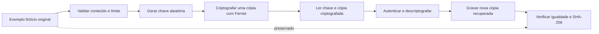

# Criptografia e recuperação de arquivos em Python

Laboratório educacional inspirado no desafio de ransomware da DIO. Implementa `encrypter.py` e `decrypter.py` para estudar criptografia simétrica e recuperação de conteúdo em um cenário controlado.

**Escopo:** os scripts trabalham exclusivamente com o arquivo fictício `laboratorio/original/exemplo.txt`. A criptografia produz uma cópia separada e preserva o original. Esta implementação não percorre pastas, não aceita caminhos externos e não inclui extorsão ou propagação.

## Objetivos

- Criptografar e descriptografar um exemplo com Python.
- Entender o papel da chave e da validação de integridade.
- Verificar que o conteúdo recuperado corresponde ao original.
- Documentar decisões técnicas e resultados reproduzíveis.
- Organizar os arquivos para uma entrega no GitHub.

## Executar no Windows

Requisitos: **Python 3.10 ou superior** e a dependência definida em `requirements.txt`.

1. Extraia o ZIP e abra a pasta que contém `encrypter.py`.
2. No Explorador de Arquivos, clique na barra de endereço, digite `powershell` e pressione Enter.
3. Execute os comandos abaixo, um por vez:

```powershell
python -m venv .venv
.\.venv\Scripts\python.exe -m pip install -r requirements.txt
.\.venv\Scripts\python.exe encrypter.py
.\.venv\Scripts\python.exe decrypter.py
```

Se `python` não for reconhecido e o inicializador Python estiver instalado, use `py -3 -m venv .venv` no primeiro comando. Os demais continuam iguais. Usar o executável da `.venv` diretamente dispensa ativar o ambiente ou alterar a política de execução do PowerShell.

O resultado fica em `laboratorio/gerados/`:

| Arquivo | Conteúdo |
| --- | --- |
| `chave-demo.key` | Chave simétrica gerada para a demonstração |
| `exemplo.txt.fernet` | Cópia criptografada do exemplo |
| `exemplo.recuperado.txt` | Cópia descriptografada, idêntica ao original |

O arquivo `laboratorio/original/exemplo.txt` permanece intacto. Para repetir todo o exercício, extraia o ZIP em uma nova pasta; uma nova execução de cada script recusa sobrescrever os resultados existentes.

## Executar no Linux ou macOS

Na pasta do projeto:

```bash
python3 -m venv .venv
.venv/bin/python -m pip install -r requirements.txt
.venv/bin/python encrypter.py
.venv/bin/python decrypter.py
```

## Fluxo do laboratório



## Funcionamento

`encrypter.py` valida o conteúdo do exemplo fornecido, gera uma chave e grava somente a chave e o token criptografado em `laboratorio/gerados/`.

`decrypter.py` lê esses arquivos, autentica e descriptografa o token, compara o conteúdo com o exemplo original e grava uma nova cópia. A saída mostra o SHA-256 correspondente ao original e ao conteúdo recuperado.

Fernet é uma receita de criptografia simétrica autenticada da biblioteca `cryptography`. A mesma chave permite criptografar e descriptografar; tokens inválidos ou adulterados são recusados. Consulte a [documentação oficial do Fernet](https://cryptography.io/en/stable/fernet/).

A comparação de bytes verifica a igualdade exata nesta demonstração. O SHA-256 exibido facilita registrar a comparação; ele não substitui a autenticação do token nem representa criptografia.

## Decisões técnicas

| Decisão | Justificativa |
| --- | --- |
| Biblioteca de criptografia mantida e versão fixada | Evitar implementar primitivas criptográficas e reproduzir o ambiente testado |
| Entrada fixa e validação do exemplo | Limitar o exercício aos dados fictícios do pacote |
| Chave aleatória gerada na execução | Evitar uma chave fixa no código |
| Cópia criptografada separada | Preservar o arquivo original |
| Criação exclusiva das saídas | Recusar sobrescrita de arquivos existentes |
| Destinos fixos dentro do projeto | Evitar selecionar arquivos pessoais por engano |
| Recusa de links simbólicos e redirecionamentos | Restringir o cenário aos caminhos previstos |
| Limite de 4 KiB para a entrada | Manter um exemplo pequeno e inteiramente em memória |
| Chave e saídas excluídas do versionamento | Separar o material de estudo dos resultados gerados |

## Testes

No Windows:

```powershell
.\.venv\Scripts\python.exe -m unittest discover -s tests -v
```

No Linux/macOS:

```bash
.venv/bin/python -m unittest discover -s tests -v
```

**Resultado registrado: 11 testes aprovados**, em 13/10/2026, com Python 3.12.14 e `cryptography` 50.0.2 no Windows. Cada teste executa os scripts em uma cópia temporária do projeto.

Os casos cobrem recuperação do conteúdo, preservação do original, recusa de sobrescrita, chave incorreta, token alterado, entrada modificada ou grande, execução fora da pasta do projeto, diferenças de quebras de linha e recusa de caminhos arbitrários.

Veja o [relatório técnico](docs/RELATORIO.md) e o [registro da execução demonstrativa](docs/EXECUCAO.txt).

## Limites

O laboratório aceita apenas o exemplo fictício fornecido e não é um gerenciador de arquivos criptografados. O original precisa permanecer disponível para a comparação didática. A chave é salva em arquivo local para permitir o estudo do fluxo; isso não constitui uma solução de gestão de chaves para produção.

Se houver falha de gravação entre a criação da chave e da cópia criptografada, pode restar um resultado parcial. O programa preserva esses arquivos e recusa sobrescrevê-los; nesse caso, repita em uma nova cópia do pacote.

Fernet mantém o timestamp de criação do token visível e processa o conteúdo em memória. Essas características são descritas em sua documentação oficial. Os controles deste exemplo não equivalem a uma auditoria contra processos concorrentes ou usuários que possam modificar o próprio código.

## Contexto do desafio

O uso malicioso da criptografia para impedir acesso a dados faz parte do problema estudado em ransomware. Aqui, o foco é compreender o mecanismo de criptografia e sua reversão em um arquivo fictício, com preservação do conteúdo original.

Para estudar prevenção e resposta a incidentes, consulte o [guia StopRansomware da CISA](https://www.cisa.gov/stopransomware/ransomware-guide).

## Estrutura

```text
.
├── README.md
├── LICENSE
├── .gitignore
├── .gitattributes
├── requirements.txt
├── encrypter.py
├── decrypter.py
├── lab_utils.py
├── laboratorio/
│   └── original/
│       └── exemplo.txt
├── tests/
│   └── test_laboratorio.py
└── docs/
    ├── RELATORIO.md
    ├── EXECUCAO.txt
    └── ENTREGA.md
```

`laboratorio/gerados/` e `.venv/` são criados durante a execução e não fazem parte do pacote para publicação.

## Entrega na DIO

Nome sugerido para o repositório: **desafio-ransomware-educacional**.

O pacote contém os dois scripts solicitados, o exemplo, a documentação e os testes. A confirmação das aulas, a publicação do novo repositório e a submissão na DIO permanecem com o participante. Leia o [roteiro de entrega](docs/ENTREGA.md).

## Referências

- [Repositório-base do desafio — cassiano-dio](https://github.com/cassiano-dio/cibersecurity-desafio-ransomware).
- [Fernet — documentação oficial](https://cryptography.io/en/stable/fernet/).
- [cryptography — pacote oficial no PyPI](https://pypi.org/project/cryptography/).
- [StopRansomware — CISA](https://www.cisa.gov/stopransomware/ransomware-guide).

## Licença

O código original desta implementação usa a licença [MIT](LICENSE). As dependências e os materiais referenciados mantêm suas próprias licenças. Projeto independente de estudo, sem vínculo oficial com a DIO.
